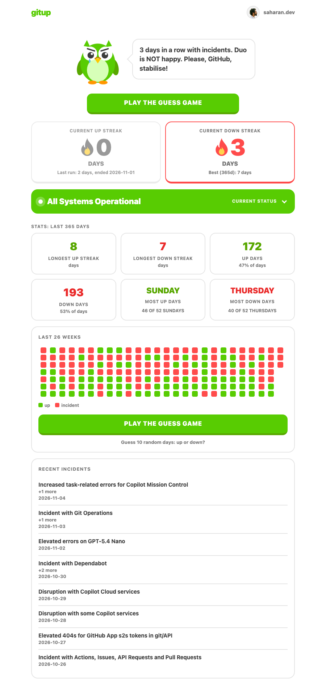
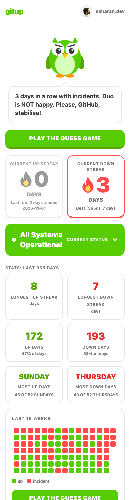
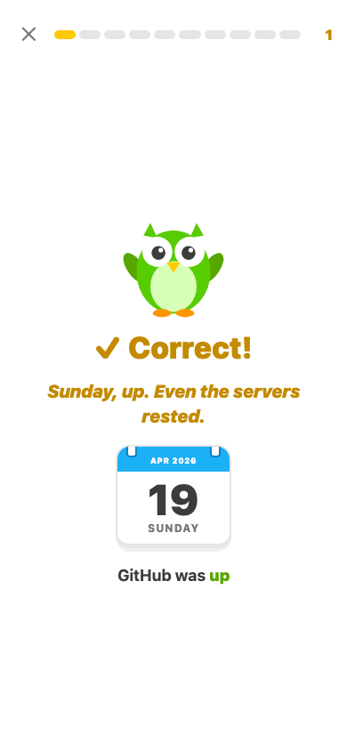

<div align="center">

# 🦉 gitup

**A nicer [githubstatus.com](https://www.githubstatus.com), with a streak and an owl.**

*I have to open githubstatus.com so often that I built a nicer version of it.*


&nbsp;&nbsp;&nbsp;

</div>

---

## What is it?

Duolingo made people care about streaks. **gitup** does the same for GitHub's reliability: how many days in a row has GitHub been **up**, and how many days in a row has it been **down**? Duo (a very judgemental owl) watches the status page so you don't have to, and cheers or sulks accordingly.

A day counts as **down** if GitHub reported at least one incident that day, and as **up** otherwise.

## Features

- 🔥 **Two streaks, side by side.** *Current up streak* and *current down streak*. One is always zero, and the other tells Duo's mood.
- 🟢 **Live status at par with githubstatus.com.** An overall banner, active incidents with their latest update, and every component (Git Operations, Actions, Copilot, ...). It refreshes every 60 seconds.
- ⚠️ **Honest banner.** If an incident is open but every component says "operational" (GitHub's own banner does this too), gitup shows *"Ongoing incident: fix deployed, monitoring"* instead of a smug green "All Systems Operational".
- 📊 **Stats for the last 365 days.** Longest up and down streaks, up and down days with percentages, and the weekday with the most of each (*"Sunday: 46 of 52 Sundays"*).
- 🗓️ **Timeline.** A GitHub-style grid of recent weeks that fits your screen: 26 weeks on desktop, fewer on phones. Hover (or tap) any day for the date and the incidents.
- 🎮 **Guess the game.** Pick a day, guess *up* or *down*, and get roasted by Duo.
  - 10 random days from the last 365, one at a time, in a full-screen, thumb-friendly modal.
  - Context-aware jokes: Monday blues, Friday deploys, Friday the 13th, Christmas, and what actually broke (*"Copilot was down. Devs briefly had to think for themselves."*).
  - Animations, haptics on phones, a calendar-page date, and a score at the end. Tap anywhere to skip ahead.
- 🚫 **Maintenance is not an incident.** Scheduled maintenance never breaks a streak.
- 🌗 Light and dark mode, `prefers-reduced-motion` support.

<div align="center">

</div>

## How it works

There is **no backend and no build step**. It is a static page plus one JSON file.

```
 ┌────────────────────────────┐        ┌──────────────────────────┐
 │ scripts/crawl.mjs          │ writes  │ data/history.json        │
 │ crawls /history?page=N     ├───────▶ │ one entry per incident   │
 │ (since 2025-01-01)         │         │ day, kept forever        │
 └────────────────────────────┘         └────────────┬─────────────┘
                                                     │ fetched by the browser
 ┌────────────────────────────┐                      ▼
 │ githubstatus.com           │   live   ┌──────────────────────────┐
 │  • history.atom            ├────────▶ │ index.html + assets/app.js│
 │  • api/v2/summary.json     │  (CORS)  │ merges both, computes     │
 └────────────────────────────┘         │ streaks in the browser    │
                                         └──────────────────────────┘
```

| Source | Used for |
| --- | --- |
| `data/history.json` | The long history (the feed only covers a few weeks). |
| `githubstatus.com/history.atom` | Recent incidents, merged over the history on every page load. |
| `githubstatus.com/api/v2/summary.json` | Current status, components, active incidents. |

Streaks are computed in the browser from the merged data, so they stay correct between crawls. All days are **UTC**, and today counts as soon as an incident is reported.

## Run it locally

You need Node.js 18+ (only for the crawler and a static server).

```bash
git clone <this-repo>
cd gitup
npm start          # serves the site at http://localhost:3000
```

> The page loads `data/history.json` with `fetch`, so open it over HTTP (as above) rather than double-clicking `index.html`.

## Keeping the history up to date

The Atom feed only holds the latest ~25 incidents, which is roughly **4 weeks now but can be 1 to 2 weeks in a busy stretch**. If `data/history.json` is older than that, days in the gap look "up" when they weren't. So refresh it regularly. **Daily is safe**, and it also picks up retroactive incidents that GitHub posts later.

```bash
npm run crawl
```

The crawler walks the paginated history pages back to 2025-01-01 (change `START_DATE` in `scripts/crawl.mjs`), **merges** into the existing file instead of overwriting it, and skips scheduled maintenance. It takes about 8 requests.

### Example: refresh daily with GitHub Actions

```yaml
# .github/workflows/crawl.yml
name: Refresh history
on:
  schedule: [{ cron: "17 3 * * *" }]
  workflow_dispatch:
permissions:
  contents: write
jobs:
  crawl:
    runs-on: ubuntu-latest
    steps:
      - uses: actions/checkout@v4
      - uses: actions/setup-node@v4
        with: { node-version: 20 }
      - run: npm run crawl
      - run: |
          git config user.name "gitup-bot"
          git config user.email "gitup-bot@users.noreply.github.com"
          git add data/history.json
          git diff --cached --quiet || (git commit -m "chore: refresh history" && git push)
```

## Deploy

It is a folder of static files, so any static host works: GitHub Pages, Cloudflare Pages, Netlify, Vercel, S3. Point the host at the repository root, with no build command.

## SEO and sharing

- **Meta:** title, description, canonical URL, `robots`, theme colour, favicon and touch icon, all in the `<head>` of `index.html`.
- **Social cards:** Open Graph and **X (Twitter) `summary_large_image`** tags, with a 1200×630 preview image at `assets/og.png`. Paste the URL into a post and you get the owl card.
- **Structured data:** JSON-LD (`WebSite` and `WebApplication`).
- **Crawling:** `robots.txt` and `sitemap.xml` at the root. Keep `data/` crawlable, because Google needs `data/history.json` to render the page.
- **Share on X buttons:** one pre-fills the *current* streak (*"GitHub has been up 12 days in a row 🟢🔥"*), and the game's result screen pre-fills your score.

The production URL (`https://gitup.lol`) is written into `index.html`, `robots.txt`, `sitemap.xml`, `package.json`, and the `SITE` constant in `assets/app.js`. Search for it if the domain ever changes. X caches cards, so after changing the image or text, re-fetch the URL in the X post composer.

## Project structure

```
.
├── index.html            # the single page
├── assets/
│   ├── app.js            # streaks, status, timeline, game, jokes
│   ├── style.css
│   ├── og.png            # 1200x630 social preview image
│   ├── favicon.svg
│   ├── apple-touch-icon.png
│   └── amit.jpg          # header avatar
├── robots.txt
├── sitemap.xml
├── data/
│   └── history.json      # incident days since 2025-01-01
├── scripts/
│   └── crawl.mjs         # history crawler
└── docs/                 # README screenshots
```

### `data/history.json`

```jsonc
{
  "generatedAt": "2026-11-04T12:41:23.294Z",
  "source": "https://www.githubstatus.com/history",
  "startDate": "2025-01-01",
  "incidentDays": {
    "2026-11-04": [
      { "id": "tc28c0wzrnpz", "name": "Increased task-related errors for Copilot Mission Control", "impact": "minor" }
    ]
  }
}
```

A date that is **missing** from `incidentDays` is an up day.

## Notes

- **Not affiliated** with GitHub, Microsoft or Duolingo. The streak idea is inspired by Duolingo. Duo here is an original owl illustration.
- Status data belongs to GitHub and comes from their public status page.
- Planned maintenance is excluded, and incidents with impact `none` (for example "Incident with Webhooks") are included because they are real incidents.

## Author

Built by [@iamamitsaharan](https://x.com/iamamitsaharan) · [saharan.dev](https://saharan.dev)

If GitHub keeps its streak up, Duo is proud. If not, Duo is watching. 🦉
